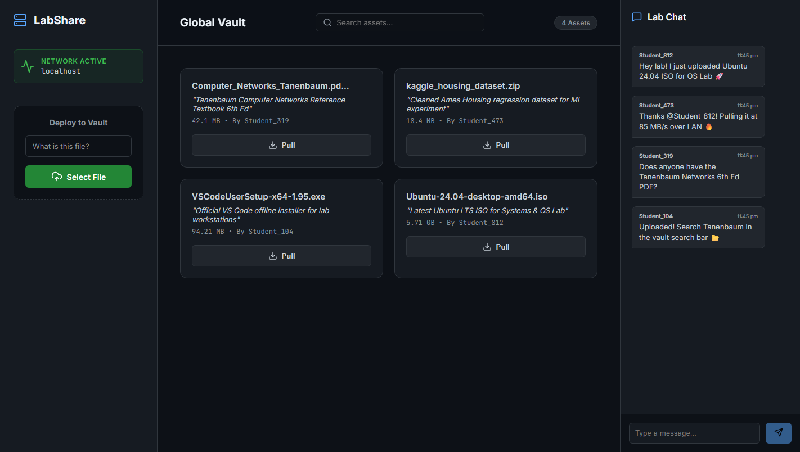
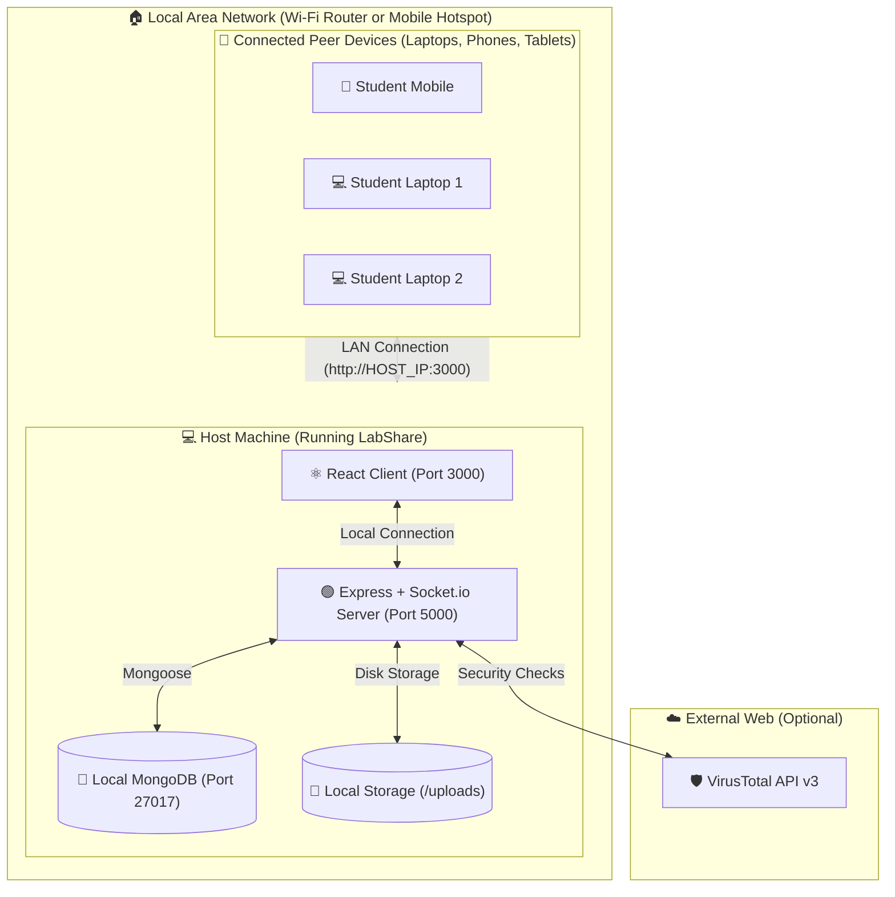
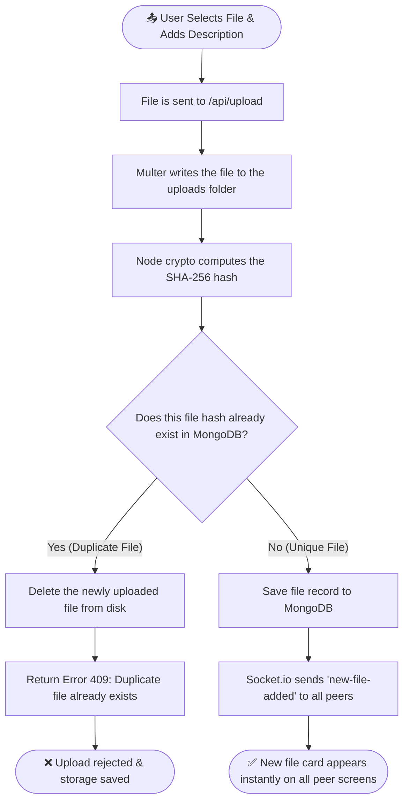
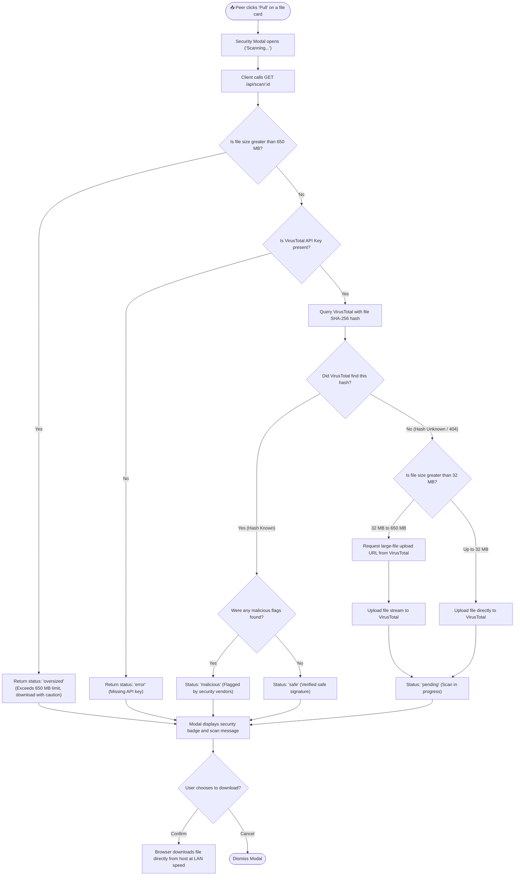
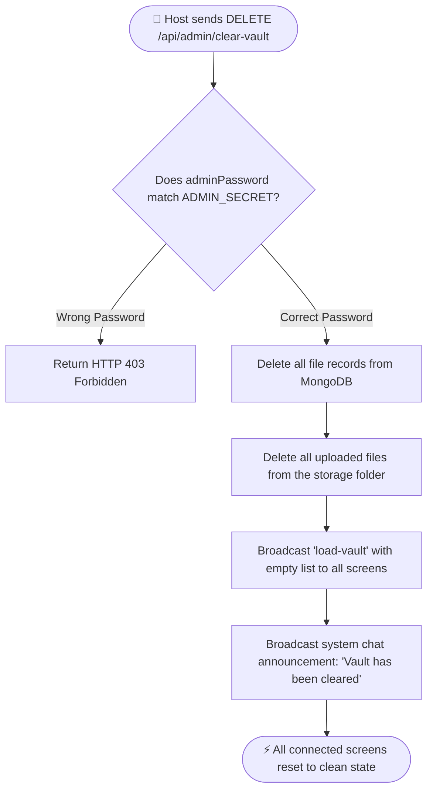

<div align="center">

# 🚀 LabShare
### Enterprise LAN File Hub & Real-Time Workspace

[](https://nodejs.org/)
[](https://react.dev/)
[](https://expressjs.com/)
[](https://www.mongodb.com/)
[](https://socket.io/)
[](https://www.virustotal.com/)

<p align="center">
  <b>A fast, local-network file sharing hub and real-time collaboration workspace designed for computer labs, classrooms, and hackathons.</b>
</p>

---



</div>

<br>

## 📖 Overview

**LabShare** is a centralized Local Area Network (LAN) file-sharing hub and real-time collaboration dashboard. In university computer labs, college classrooms, and hackathons, dozens of students often need to download the exact same large files—such as virtual machine OS images (ISOs), machine learning datasets, software installers, or digital textbooks. When everyone downloads from the internet at the same time, external internet connections slow down to a crawl.

LabShare solves this problem by allowing one person to host the files locally. Connected peers on the same Wi-Fi router or mobile hotspot can upload and download heavy files directly between devices at the full speed of the local router. No external internet bandwidth is consumed for file transfers, and no account registration is required.

---

## ✨ Key Features

* **⚡ Fast Local Network Streaming:**
  Files are streamed directly to server disk storage using Multer without overloading system memory (RAM). Peers download files directly from the host at maximum local router speed.

* **🛡️ Pre-Download Security Check (VirusTotal Integration):**
  Peers can inspect files before saving them to their machines:
  * **Instant Hash Lookup:** First checks the file's SHA-256 fingerprint against the VirusTotal database.
  * **Automatic Upload Fallback:** If the file is unknown to VirusTotal, the backend automatically uploads it for scanning (supports files up to 650 MB). Files over 650 MB trigger an advisory notice.

* **💾 Smart Storage Deduplication:**
  Every uploaded file gets a cryptographic SHA-256 fingerprint. If an identical file already exists in the Global Vault, the server rejects the duplicate, deletes the newly uploaded copy from the disk, and notifies the user to prevent wasted storage.

* **💬 Live Lab Chat:**
  Built-in real-time messaging powered by Socket.io. Connected peers can request files, ask lab questions, and coordinate work across the room with instant message updates and automatic smooth scrolling.

* **🔍 Live Asset Search:**
  Easily find files in the vault using a real-time search bar that filters by file name instantly as you type.

* **🧠 Frictionless Identity:**
  Zero sign-up hassle. When a user opens LabShare, their browser assigns and remembers a persistent random peer identifier (e.g., `Student_473`) in `localStorage` across reloads without requiring usernames or passwords.

* **🛑 Host "Nuke" Admin Protocol:**
  A password-protected admin endpoint allows the host to completely wipe the vault between demo sessions or classes—deleting database records, clearing the physical storage folder, and immediately updating all connected peer screens via WebSockets.

---

## 🏗️ Interactive Flowcharts

<details>
<summary><b>🔍 1. How Devices Connect on the LAN (Click to expand)</b></summary>
<br>



</details>

<details>
<summary><b>🔍 2. File Upload & Duplicate Detection (Click to expand)</b></summary>
<br>



</details>

<details>
<summary><b>🔍 3. Pre-Download Security Scan (Click to expand)</b></summary>
<br>



</details>

<details>
<summary><b>🔍 4. Admin Vault Reset Protocol (Click to expand)</b></summary>
<br>



</details>

---

## 🛠️ Technology Stack

| Layer | Technology | Role |
| :--- | :--- | :--- |
| **Frontend UI** | **React.js 19** | Modern reactive component interface |
| **Styling** | **CSS3 Grid & Flexbox** | Clean dark theme with responsive mobile layout |
| **Icons** | **Lucide-React** | Intuitive visual icons for files, downloads, and status indicators |
| **Real-Time Engine** | **Socket.io (v4)** | Instant live updates for vault additions, chat, and resets |
| **Backend API** | **Node.js & Express.js (v5)** | High-performance server with local network binding |
| **Database** | **MongoDB & Mongoose (v9)** | Stores file details, uploader names, and unique file hashes |
| **File Handling** | **Multer (v2)** | Efficient disk storage streaming |
| **Security Scanning** | **VirusTotal API v3 & Node Crypto** | SHA-256 fingerprinting and pre-download malware scanning |

---

## 📁 Repository Structure

```plaintext
LabShare/
├── assets/
│   ├── dashboard.png                 # Live UI screenshot
│   └── labshare-dashboard.png        # High-resolution UI screenshot
├── backend/
│   ├── models/
│   │   └── File.js                   # MongoDB schema for file records
│   ├── uploads/                      # Storage folder for uploaded files (auto-created)
│   ├── .env.example                  # Environment configuration template
│   ├── .gitignore                    # Node modules & uploads ignore rules
│   ├── package.json                  # Backend dependencies and scripts
│   └── server.js                     # Express server, Socket.io events, and VirusTotal logic
├── frontend/
│   ├── public/
│   │   ├── index.html                # Main HTML template
│   │   └── manifest.json             # Web app metadata
│   ├── src/
│   │   ├── App.css                   # Complete dark-mode theme & mobile styles
│   │   ├── App.js                    # Core dashboard UI (vault, chat, modals, upload)
│   │   ├── index.css                 # Global typography and base styles
│   │   └── index.js                  # React application entry point
│   ├── package.json                  # Frontend dependencies and scripts
│   └── .gitignore                    # Frontend build ignores
└── README.md                         # Documentation
```

---

## 🚦 Local Installation & Setup Guide

Follow these simple steps to run LabShare on your machine.

### Prerequisites
1. **Node.js** installed on your computer.
2. **MongoDB** installed and running locally on port `27017`.
3. A free **VirusTotal API Key** (optional, but needed for security scans). You can get one for free at [virustotal.com](https://www.virustotal.com/).

---

### Step 1: Clone the Repository
```bash
git clone https://github.com/Parth-Chavan-15/LabShare.git
cd LabShare
```

---

### Step 2: Set Up the Backend

1. Navigate to the `backend` folder and install dependencies:
   ```bash
   cd backend
   npm install
   ```

2. Create your `.env` configuration file:
   ```bash
   # On Windows (PowerShell):
   Copy-Item .env.example .env

   # On macOS or Linux:
   cp .env.example .env
   ```

3. Open `.env` and verify your settings:
   ```env
   PORT=5000
   MONGO_URI=mongodb://127.0.0.1:27017/labshare_db
   VT_API_KEY=your_virustotal_api_key_here
   ADMIN_SECRET=your_custom_admin_password
   ```

4. Start the backend server:
   ```bash
   npx nodemon server.js
   ```
   *(Or run `node server.js` directly)*

   When connected, you will see:
   ```plaintext
   🚀 LabShare Hub running on port 5000
   📦 Connected to MongoDB LabShare Vault
   ```

---

### Step 3: Set Up the Frontend

1. Open a second terminal window, navigate to the `frontend` folder, and install dependencies:
   ```bash
   cd frontend
   npm install
   ```

2. Start the React application:
   ```bash
   npm start
   ```

3. The dashboard will automatically open in your browser at `http://localhost:3000`.

---

## 🌐 How to Share with the Lab (LAN Access)

To let other devices on the same Wi-Fi network connect to your LabShare vault:

1. **Connect to the Same Network:** Ensure your host computer and your peers' devices (laptops, phones) are connected to the exact same Wi-Fi router or mobile hotspot.
2. **Find Your Local IPv4 Address:**
   * **Windows:** Open PowerShell and type `ipconfig`. Find the `IPv4 Address` under your active Wi-Fi connection (e.g., `192.168.1.55`).
   * **macOS:** Open Terminal and type `ipconfig getifaddr en0`.
   * **Linux:** Open Terminal and type `hostname -I` or `ip a`.
3. **Share the Link with Peers:**
   Tell peers on your network to open their browser and visit:
   ```text
   http://<YOUR_IP_ADDRESS>:3000
   ```
   *(For example: `http://192.168.1.55:3000`)*

> [!TIP]
> **Firewall Note (Windows):** If peers cannot connect or the page times out, check that Windows Defender Firewall allows incoming connections on ports `3000` and `5000`. You can grant access in PowerShell (Run as Administrator):
> ```powershell
> New-NetFirewallRule -DisplayName "LabShare Web" -Direction Inbound -LocalPort 3000,5000 -Protocol TCP -Action Allow
> ```

---

## 🛑 Admin "Nuke" Protocol (Resetting the Vault)

When you finish a lab class or demo session and want to clear out all files and chat messages:

### Using cURL:
```bash
curl -X DELETE http://localhost:5000/api/admin/clear-vault \
  -H "Content-Type: application/json" \
  -d '{"adminPassword": "your_custom_admin_password"}'
```

### Using Postman or Thunder Client:
* **Method:** `DELETE`
* **URL:** `http://localhost:5000/api/admin/clear-vault`
* **Header:** `Content-Type: application/json`
* **JSON Body:**
  ```json
  {
    "adminPassword": "your_custom_admin_password"
  }
  ```

---

## 💡 Frequently Asked Questions

<details>
<summary><b>Q: What happens if someone uploads the exact same file under a different name?</b></summary>
<br>
LabShare checks the file's binary contents using SHA-256 hashing rather than relying on the filename. If the contents match an existing file, the server recognizes it as a duplicate, deletes the duplicate file from the hard drive, and shows an alert.
</details>

<details>
<summary><b>Q: Do peers need an internet connection to use LabShare?</b></summary>
<br>
No. As long as all devices are connected to the same local Wi-Fi router or mobile hotspot, all file transfers and chat work completely offline without an active internet connection. An internet connection is only needed if you wish to run VirusTotal scans against external security servers.
</details>

<details>
<summary><b>Q: Why do peers get a connection timeout when trying to visit my IP?</b></summary>
<br>
This is almost always due to the host computer's firewall blocking incoming connections on ports 3000 or 5000, or the router having "Client Isolation" turned on. Opening the ports in the host firewall resolves this.
</details>

---

## 📄 License & Attribution

Distributed under the **ISC License**. Developed by [Parth Chavan](https://github.com/Parth-Chavan-15).

<div align="center">
  <sub>Engineered with ❤️ for seamless local network collaboration.</sub>
</div>
